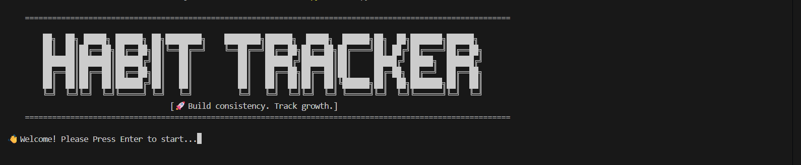
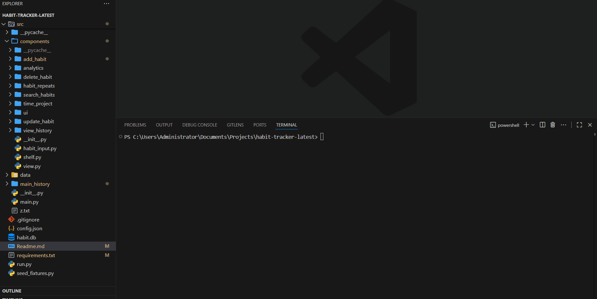
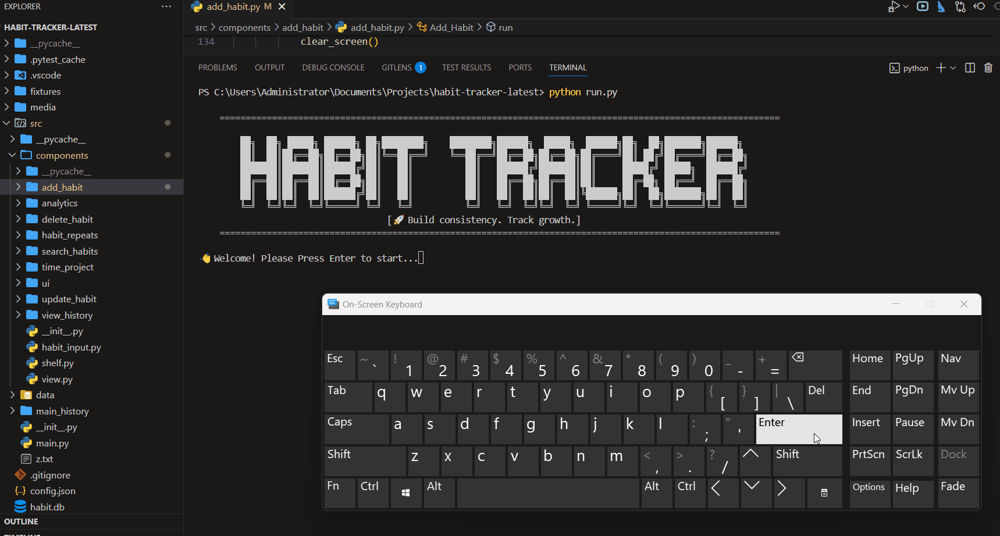
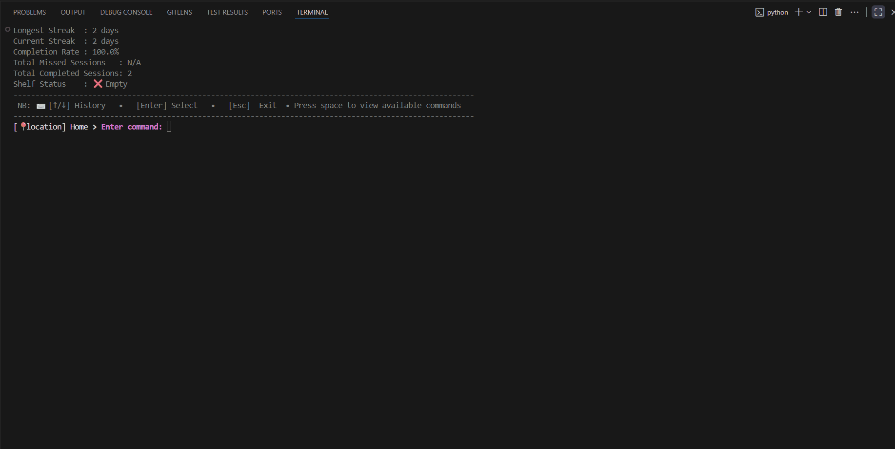
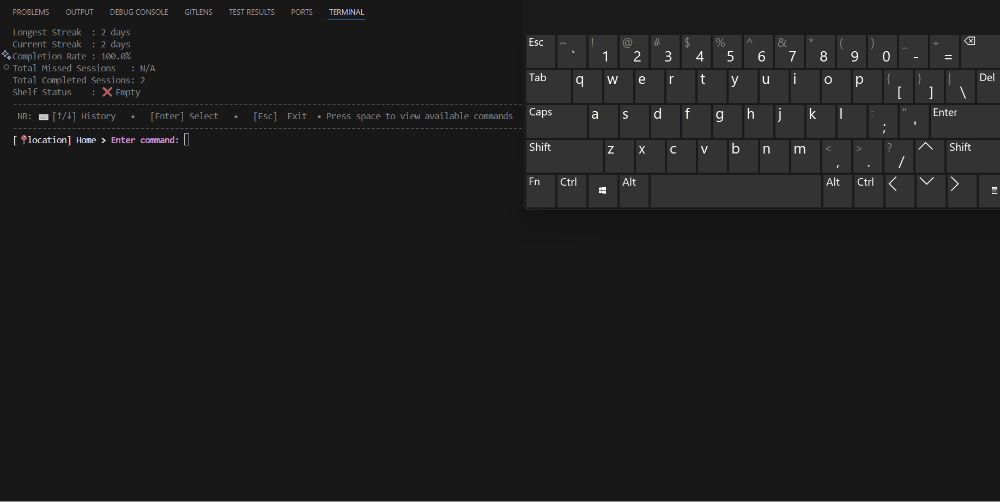
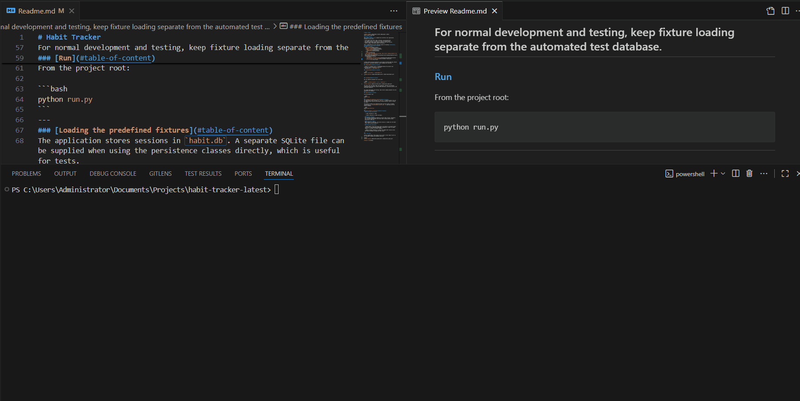
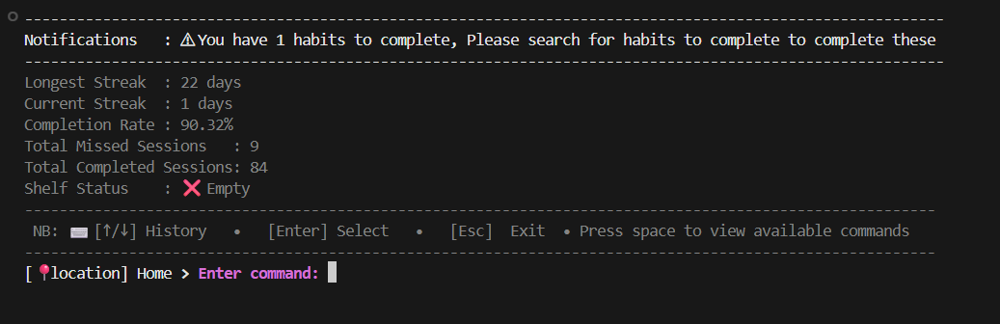
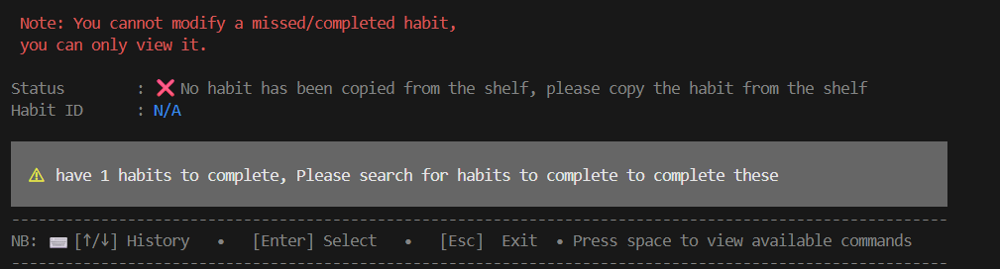
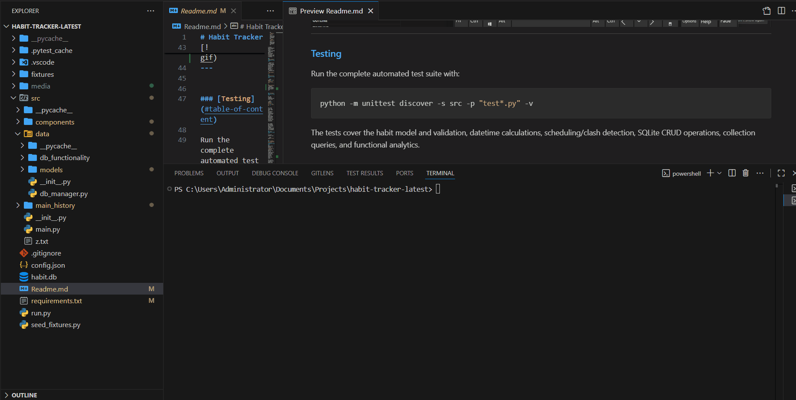

# Habit Tracker

[](./media/habit_tracker_image.png)

## Project Purpose
This **Habit Tracker** is a Python habit-tracking command-line interface application using object-oriented modelling, SQLite persistence, functional analytics, and a command-line interface, designed to help users to track and manage habits.

It’s a fully featured system for building **consistency, accountability, and growth tracking**.


## Table of content
- [Habit Tracker](#habit-tracker)
  - [Project Purpose](#project-purpose)
  - [Table of content](#table-of-content)
      - [Detailed guides for specific features/user actions:](#detailed-guides-for-specific-featuresuser-actions)
    - [Notification(s) screens](#notifications-screens)
  - [](#)
    - [Loading the predefined fixtures](#loading-the-predefined-fixtures)
    - [Testing](#testing)
    
1. ### [Requirements](#table-of-content)

   - Python 3.7+ (Python 3.10+ is recommended because the project uses structural pattern matching in the CLI.)
   - Dependencies in `requirements.txt`

2. ### [Installation](#table-of-content)

    ```bash
      python -m pip install -r requirements.txt
    ```
    [](./media/requirements.gif)
---


3. ### [Core Concepts & Time Units](#table-of-content)
   This is the project of projects, each project is treated as a main folder
   with sub-folders inside. The sub-folders are points at which a user has to put in an input. You look at what is shown below to see where you are in the project:
   <!-- picture showing main and other project -->

   To choose a project, navigating inside it you must press
   space you will get something like what you see below:
   <!-- picture showing options -->

   To move out of the subfolder or project must use esc

   In this project we roughly have 3 types of projects:
    1. The ones that acts on a habit(habit repeat, delete habit, update habit).
    2. The one that searches, finds and selects what you want to act on(Search habits).
    3. The one that creates habit sessions(add habit).
     
    In order for you to use the projects that act on a habit you must first search and select the habit you want to act on. That habit will be added on what we call a shelf. What is in a shelf can be accessed by any project that can act on it. Before you can act on a habit session you must copy it from the shelf in that project you want to use to act on it. e.g you want to update a habit, you must go search for it and select it. The navigate back to update then copy the habit from the shelf and then you act act on it i.e update it.

    These are important definitions you must know to understand how this works:
   - #### Time Scale Definitions:

     - 1 Week: Defined as 7 days.

     - 1 Month: Defined as 4 weeks (28 days).

   - #### Session Creation: 
     All workflows originate by adding an initial habit session. Parameters pass through HabitValidator and clash check routines before being persisted to habit.db.

   - ##### The Active "Shelf": 
     Upon creation or selection, the active session is loaded into the Shelf state (Shelf.preserve_habit()).

   - #### Downstream Operations:

     - Repeat Habits: Uses the session held on the Shelf to calculate future recurrences using HabitDateTimeManager (stepping by 7 days for weekly repeats, or 28 days for monthly repeats).

     - Update & Delete: Modifies or purges the staged shelf session across both SQLite database storage and local cache.


4. ### [Pro Tips](#table-of-content)

    - `The home screen interface also supports common commands:`

       - esc   —  exits the current Home screen.

       - clear  —  clears the terminal screen.

       - Space  —  displays available commands.

       - ↑ / ↓ — navigates through previously entered commands using command history.
  
   - `Visual examples:`
     - `Instant Command Menu: Press Space at any screen or menu stage to pull up all available commands and keyboard shortcuts.`

       [](./media/press_space.gif)

        
     - `Command History: Use the Up (↑) and Down (↓) arrow keys to navigate and view the history of previously typed commands in the terminal.`
       
       [](./media/history_viewing.gif)
     - `Stopping the program or escaping the screen: Use esc to escape a particular screen or to sto the program.`
        [](/media/escape.gif)

5. ### [Run](#table-of-content)

   From the project root:

   ```bash
   python run.py
   ```
   [](./media/run_program.gif)

   #### Detailed guides for specific features/user actions:
     - [Adding or creating a habit session](/src/components/add_habit/Readme.md)
     - [Deleting a habit session](/src/components/delete_habit/Readme.md)
     - [Updating or Completing a habit session](/src/components/update_habit/Readme.md)
     - [Searching for habit sessions or a habit session](/src/components/search_habits/Readme.md)
     - [repeating a habit session daily,weekly,monthly etc](/src/components/habit_repeats/Readme.md)
---
### [Notification(s) screens](#table-of-content)
When you have a session that you must update the home screen will look as shown below:

[](/media/home_screen_notification.png)

When you have a session that you must the other screens will look as shown below:

[](/media/notification_on_other_screens.png)
---
### [Loading the predefined fixtures](#table-of-content)
   The application stores sessions in `habit.db`. A separate SQLite file can be supplied when using the persistence classes directly, which is useful for tests.

   The project includes five predefined habits and four weeks of example tracking data in `fixtures/habits_fixture.json`. To load them into the default database:

   ```bash
   python seed_fixtures.py
   ```
---
### [Testing](#table-of-content)

Run the complete automated test suite with:

```bash
python -m unittest discover -s src -p "test*.py" -v
```
[](./media/press_space.gif)

The tests cover the habit model and validation, datetime calculations and scheduling/clash detection, SQLite CRUD operations.

[⬆ Back to top](#top)