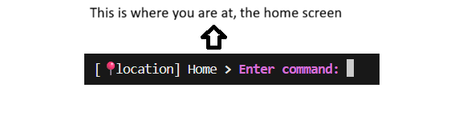
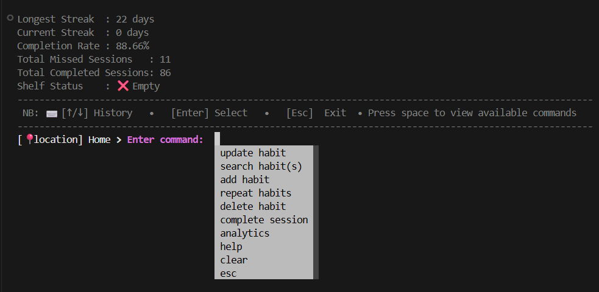

# Habit Tracker

[](./media/habit_tracker_image.png)

## Project Purpose
This Habit Tracker is a Python-based habit-tracking command-line application that uses object-oriented modelling, SQLite persistence, functional analytics, and a terminal interface. It is designed to help users build and maintain productive routines through structured habit tracking and guided command-line workflows.

It is a fully featured system for building consistency, accountability, and growth tracking.

## Project Features
This project includes a full set of habit-tracking features for creating, managing, and reviewing routines from a terminal interface.

### Core features
- Habit creation and validation: add new habits with a name, start date/time, duration, and status validation.
- Habit search and filtering: find habits by date, time, duration, name, and status; also view pending tasks awaiting confirmation.
- Habit update and completion: update existing habit details and mark sessions as completed when appropriate.
- Habit deletion: safely remove habits after selecting the active habit and confirming the action.
- Habit repetition: repeat a habit daily, weekly, or monthly using the active shelf session as the base.
- Active shelf workflow: keep a selected habit available for follow-up actions across screens.
- Notification and status tracking: surface missed, ongoing, upcoming, and completion-pending habit states.
- SQLite persistence: store and retrieve habits using a database-backed model with cached data access.
- Project-based CLI navigation: work through a command-driven menu system with autocompletion, history, and guided prompts.
- Fixture-based demos: load predefined example data to explore the application quickly.

### Feature areas in the project
- Add Habit: create a new habit session from the terminal.
- Search Habit: filter existing habits using multiple criteria.
- Update Habit: edit session attributes or complete a pending task.
- Delete Habit: remove a selected habit safely.
- Repeat Habit: generate future schedule instances from an existing habit.
- CLI utilities: use keyboard shortcuts, screen navigation, and form validation throughout the app.

## Table of Contents
- [Habit Tracker](#habit-tracker)
  - [Project Purpose](#project-purpose)
  - [Project Features](#project-features)
    - [Core features](#core-features)
    - [Feature areas in the project](#feature-areas-in-the-project)
  - [Table of Contents](#table-of-contents)
    - [Requirements](#requirements)
    - [Installation](#installation)
    - [Core Concepts & Time Units](#core-concepts--time-units)
    - [Pro Tips](#pro-tips)
    - [Run](#run)
    - [Loading the Predefined Fixtures](#loading-the-predefined-fixtures)
    - [Notification Screens](#notification-screens)
    - [Detailed Guides for Specific Features and User Actions](#detailed-guides-for-specific-features-and-user-actions)
    - [Testing](#testing)

## Requirements

- Python 3.7+ (Python 3.10+ is recommended because the project uses structural pattern matching in the CLI.)
- Dependencies listed in `requirements.txt`

## Installation

```bash
python -m pip install -r requirements.txt
```

[](./media/requirements.gif)

---

## Core Concepts & Time Units
This project is organized into projects, each represented as a main folder with subfolders inside. These subfolders are points where the user enters data. The images below show how to navigate the project.

<!-- picture showing main and other project -->
[](./media/location_example.png)

To navigate inside a project, press the space bar. This opens a menu similar to the one shown below:

<!-- picture showing options -->
[](./media/options.png)

Note: To move out of a subfolder or project, use `Esc`. To navigate the menu you must press the up arrow and the down arrow(`↑ / ↓`), to choose an option you must press `Enter`

In this project, there are roughly three types of projects:
1. Projects that act on habit sessions (for example, repeat, delete, and update habits).
2. Projects that search, find, and select the habit session to be acted on.
3. Projects that create habit sessions.

To use the projects that act on a habit session, you must first search for and select the habit session you want to work on. That habit session is then added to what is called a shelf. The content is then available for operations like update, delete, and repeat.

These are important definitions you should understand:

### Time Scale Definitions
- 1 Week = 7 days
- 1 Month = 4 weeks (28 days)

### Session Creation
All workflows begin by adding an initial habit session. Parameters pass through `HabitValidator` and clash-check routines before being persisted to `habit.db`.

### Habit Session Statuses
Each habit session has a status. The most important statuses are described below:
- `UPCOMING`: The session has not started yet.
- `ONGOING`: The session has started and is still in progress.
- `TO_BE_CONFIRMED`: The session has started and ended, but it has not been marked as completed yet. Please see the update flow for details.
- `MISSED`: More than 24 hours have passed since the start or end of the session without it being completed.
- `COMPLETED`: The planned activity was done and the session was marked as completed.

### The Active Shelf
When a session is created or selected, the active session is loaded into the shelf state (`Shelf.preserve_habit()`).

### Downstream Operations
- Repeat Habits: Uses the session currently on the shelf to calculate future recurrences. Weekly repeats advance by 7 days, and monthly repeats advance by 28 days.
- Update & Delete: Modifies or removes the staged shelf session in both the SQLite database and the local cache.

---

## Pro Tips

- The home screen interface supports common commands:
  - `Esc` — exits the current screen
  - `clear` — clears the terminal screen
  - `Space` — displays available commands
  - `↑ / ↓` — navigates through command history

- Visual examples:
  - Instant Command Menu: Press `Space` at any screen or menu to open all available commands and keyboard shortcuts.

    [](./media/press_space.gif)

  - Command History: Use the up and down arrow keys to view previously entered commands.

    [](./media/history_viewing.gif)

  - Exiting the program or closing a screen: Use `Esc` to leave a particular screen or stop the program.

    [](./media/escape.gif)

---

## Run
From the project root:

```bash
python run.py
```

[](./media/run_program.gif)

### Detailed Guides for Specific Features and User Actions
- [Adding or Creating a Habit Session](./src/components/add_habit/Readme.md)
- [Deleting a Habit Session](./src/components/delete_habit/Readme.md)
- [Updating or Completing a Habit Session](./src/components/update_habit/Readme.md)
- [Searching for Habit Sessions](./src/components/search_habits/Readme.md)
- [Repeating a Habit Daily, Weekly, or Monthly](./src/components/habit_repeats/Readme.md)

---

## Notification Screens
When you have a session that must be completed, the home screen will look like the example below:

[](./media/home_screen_notification.png)

When you have a session that must be completed on other screens, those screens will look like the example below:

[](./media/notification_on_other_screens.png)

---

## Loading the Predefined Fixtures
The application stores sessions in `habit.db`. A separate SQLite file can also be supplied when using the persistence classes directly, which is useful for tests.

The project includes five predefined habits and four weeks of example tracking data in `fixtures/habits_fixture.json`. To load them into the default database:

```bash
python seed_fixtures.py
```

---

## Testing
Run the complete automated test suite with:

```bash
python -m unittest discover -s src -p "test*.py" -v
```

[](./media/run_tests.gif)

The tests cover the habit model and validation, datetime calculations, scheduling, clash detection, and SQLite CRUD operations.

[⬆ Back to top](#top)
