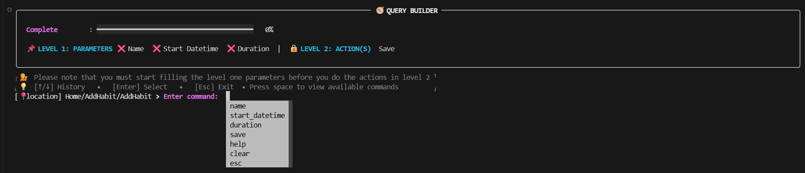
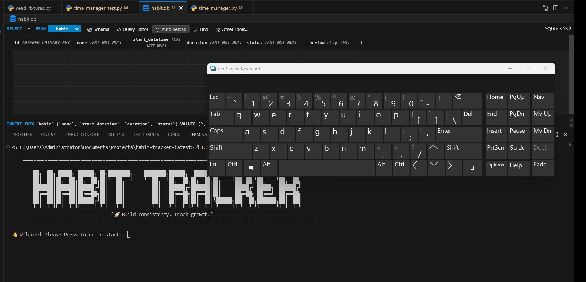
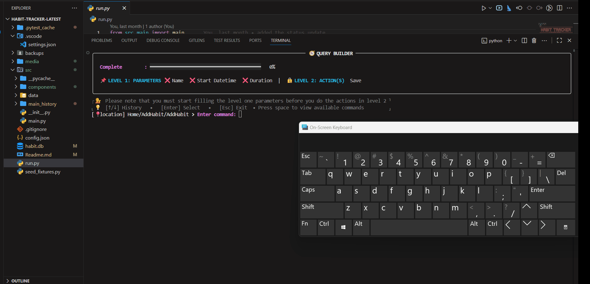
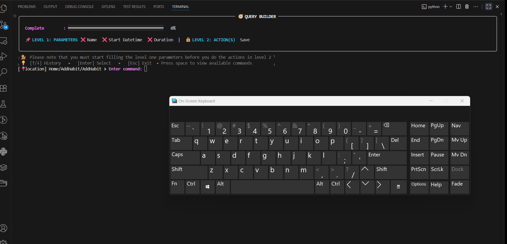
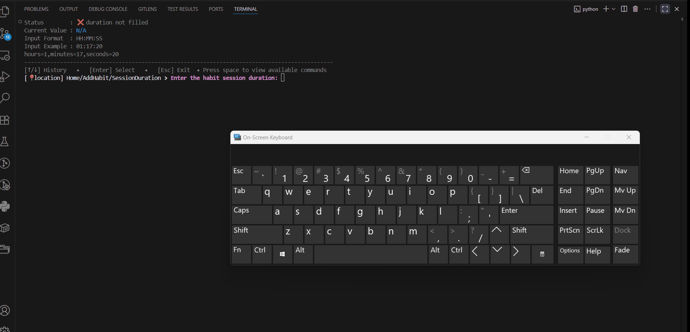

>[Go back home](../../../Readme.md)

# Add Habit


## Add Component Purpose

The **Add Habit** component is responsible for guiding the user through creating a new habit in the command-line interface.

It collects all required habit fields, validates user input, and finally saves the habit.

This component follows a **command-driven interaction loop**, where each user action is mapped to appropriate methods.

Gifs can be used to illustrate steps for the user in action.

---

## Table of Contents
- [Add Habit](#add-habit)
  - [Add Component Purpose](#add-component-purpose)
  - [Table of Contents](#table-of-contents)
  - [High-Level Flow](#high-level-flow)
  - [Command Loop](#command-loop)
  - [Testing](#testing)

  
## [High-Level Flow](#table-of-contents)


- ### Create a habit
  1.  ### user enters the add habit component screen.
  2.  ### enter field values
      - Enter name
      - Enter start datetime
      - Enter session duration 
  3.  ### save habit
      - Save the habit


      Gif example of the high level flow:

      
- Go back to the home screen (select esc)
- Clear the screen(select clear)
- get help(select help)

---

## [Command Loop](#table-of-contents)


Available commands:

| Command                      | Description                  | format or rule(s)         | Gif                                           |
| ---------------------------- | -----------------------------| ---------------------------------------------  | --------------------------------------------- |
| `name`             | Sets the habit name        | name is required and must have more than 3 characters          |         |
| `start_datetime`         | Sets the start date and time| YYYY-MM-DD HH:MM:SS e.g 2026-11-28 13:30:00  |   |
| `duration` | Sets the session duration     |HH:MM:SS e.g 13:30:00   |   |

Each command maps directly to a handler method.

---
## [Testing](#table-of-contents)
```bash
python -m unittest discover -s src/components/add_habit/test
```