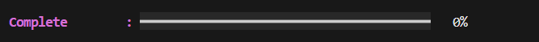
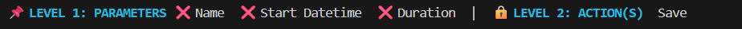

>[Go back home](../../../Readme.md)

# Add Habit

<!-- start-purpose -->
## Add Component Purpose
The **Add Habit** component is responsible for guiding the user through creating a new habit in the command-line interface.

It collects all required habit fields, validates user input, and finally saves the habit.

This component follows a **command-driven interaction loop**, where each user action is mapped to appropriate methods.
<!-- end-purpose -->

Gifs can be used to illustrate steps for the user in action.

---
<!-- start-table-of-content -->
## Table of Contents
- [Add Habit](#add-habit)
  - [Add Component Purpose](#add-component-purpose)
  - [Table of Contents](#table-of-contents)
  - [High-Level Flow](#high-level-flow)
    - [Steps to create a habit](#steps-to-create-a-habit)
    - [Screen views](#screen-views)
    - [Here are features we have:](#here-are-features-we-have)
      - [NB: For how things change as you fill in please look at the Gifs below. Another thing is that you cannot be locked to any level after filling everything in level 1.](#nb-for-how-things-change-as-you-fill-in-please-look-at-the-gifs-below-another-thing-is-that-you-cannot-be-locked-to-any-level-after-filling-everything-in-level-1)
  - [Command Loop](#command-loop)
  - [Testing](#testing)
<!-- end-table-of-content -->

<!-- start-high-level-view -->
## [High-Level Flow](#table-of-contents)
### [Steps to create a habit](#table-of-contents) 
  1.  ### user enters the add habit component screen.
  2.  ### enter field values
      - Enter name
      - Enter start datetime
      - Enter session duration 
  3.  ### save habit
      - Save the habit
<!-- end-high-level-view -->

      Gif example of the high level flow:

  [](../add_habit/media/add_habit.gif)
- Go back to the home screen (select esc)
- Clear the screen(select clear)
- get help(select help)

---
### [Screen views](#table-of-contents) 
[](../add_habit/media/add_habit.png)

### Here are features we have:
- #### Completion bar :

  This is used to show the progress of filling fields.

  [](../add_habit/media/progress_bar.png)

- #### Fields and Levels:

  There are different levels and fields. There is Level one on the left and level 2. The padlock at level 2 means the action of saving is locked. If you fill all of the fields in level 1 then the padlock will open for you to save the habit. Things in level 1 can be filled anyhow it doesn't matter.

  [](../add_habit/media/key_fields.png)

#### NB: For how things change as you fill in please look at the Gifs below. Another thing is that you cannot be locked to any level after filling everything in level 1.

## [Command Loop](#table-of-contents)

Available commands:

| Command                      | Description                  | format or rule(s)         | Gif                                           |
| ---------------------------- | -----------------------------| ---------------------------------------------  | --------------------------------------------- |
| `name`             | Sets the habit name        | name is required and must have more than 3 characters          | [](../add_habit/media/enter_name.gif)        |
| `start_datetime`         | Sets the start date and time| YYYY-MM-DD HH:MM:SS e.g 2026-11-28 13:30:00  | [](../add_habit/media/enter_datetime.gif)  |
| `duration` | Sets the session duration     |HH:MM:SS e.g 13:30:00   | [](../add_habit/media/enter_duration.gif)  |

Each command maps directly to a handler method.

---
## [Testing](#table-of-contents)
```bash
python -m unittest discover -s src/components/add_habit/test
```
[⬆ Back to top](#top)