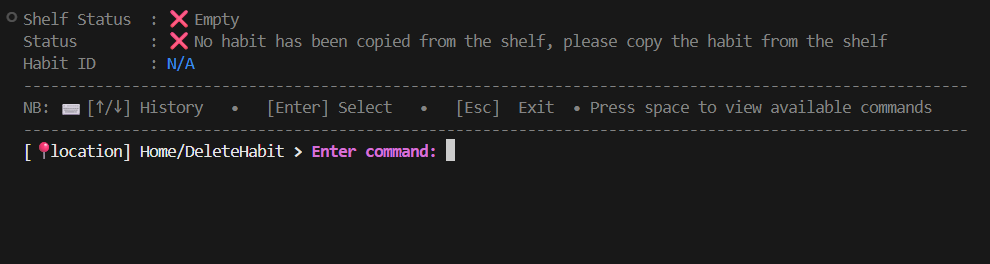
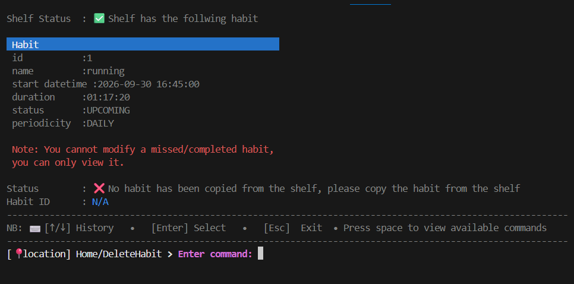
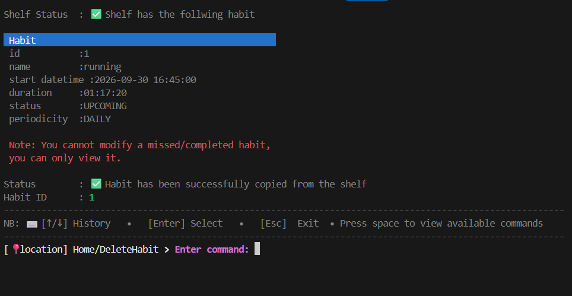
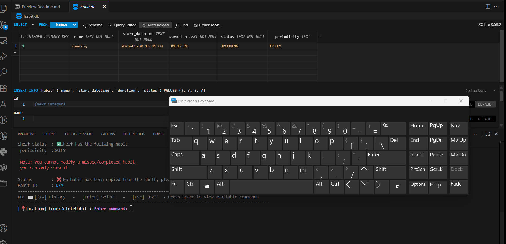

>[Go back home](../../../Readme.md)

# Delete Habit


## Delete Component Purpose


The **DeleteHabitController** component allows users to safely delete a habit from the database via the command-line interface.

It ensures:

* Habit exists before deletion
* Reflections and descriptions are preserved until deletion
* User confirmation before removing

This component follows a **command-driven interaction loop**, where each user action is mapped to appropriate methods.

Gifs can be used to illustrate steps for the user in action.

---

## Table of Contents
- [Delete Habit](#delete-habit)
  - [Delete Component Purpose](#delete-component-purpose)
  - [Table of Contents](#table-of-contents)
  - [High-Level Flow](#high-level-flow)
    - [Screen views](#screen-views)
      - [Delete habit screen without grabbing any habit](#delete-habit-screen-without-grabbing-any-habit)
      - [Delete habit screen view with grabbed any habit but didn't copy it from the shelf](#delete-habit-screen-view-with-grabbed-any-habit-but-didnt-copy-it-from-the-shelf)
      - [Delete habit screen view with grabbed any habit copied from the shelf](#delete-habit-screen-view-with-grabbed-any-habit-copied-from-the-shelf)
    - [Steps to delete a habit](#steps-to-delete-a-habit)
  - [Testing](#testing)

  
## [High-Level Flow](#table-of-contents)
### [Screen views](#table-of-contents) 
  #### Delete habit screen without grabbing any habit
  

  #### Delete habit screen view with grabbed any habit but didn't copy it from the shelf
  

  #### Delete habit screen view with grabbed any habit copied from the shelf
  

### [Steps to delete a habit](#table-of-contents)
  1.  ### [Search for a habit you want to delete]()
  2.  ### Copy habit to the shelf
  3.  ### Delete habit

  Gif example of the high level flow:

  
- Go back to the home screen (select esc)
- Clear the screen(select clear)
- get help(select help)

---

## [Testing](#table-of-contents)
```bash
python -m unittest discover -s src/components/delete_habit/test
```