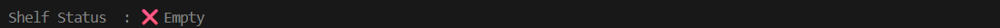
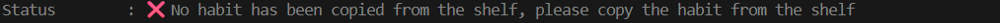
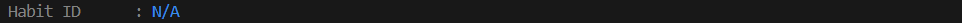

>[Go back home](../../../Readme.md)

# Delete Habit

<!-- start-purpose -->
## Delete Component Purpose

The Delete Habit component allows users to safely delete a habit from the database through the command-line interface.

It ensures that:

* the habit exists before deletion
* reflections and descriptions are preserved until deletion
* the user confirms the action before the habit is removed

This component follows a command-driven interaction loop, where each user action is mapped to an appropriate method.
<!-- end-purpose -->

GIFs can be used to illustrate the steps for the user.

---
<!-- start-table-of-content -->
## Table of Contents
- [Delete Habit](#delete-habit)
  - [Delete Component Purpose](#delete-component-purpose)
  - [Table of Contents](#table-of-contents)
  - [High-Level Flow](#high-level-flow)
    - [Steps to Delete a Habit](#steps-to-delete-a-habit)
    - [Screen Views](#screen-views)
      - [Elements of the Delete Screen](#elements-of-the-delete-screen)
      - [Delete Habit Screen Without a Habit on the Shelf](#delete-habit-screen-without-a-habit-on-the-shelf)
      - [Delete Habit Screen With a Habit on the Shelf but Not Copied](#delete-habit-screen-with-a-habit-on-the-shelf-but-not-copied)
      - [Delete Habit Screen With a Habit Copied from the Shelf](#delete-habit-screen-with-a-habit-copied-from-the-shelf)
  - [Testing](#testing)
<!-- end-table-of-content -->

---
<!-- start-high-level-view -->
## [High-Level Flow](#table-of-contents)
### [Steps to Delete a Habit](#table-of-contents)
1. ### [Search for the habit you want to delete](./src/components/search_habits/Readme.md)
2. ### Copy the habit to the shelf
3. ### Delete the habit
<!-- end-high-level-view -->

GIF example of the high-level flow:

[](../delete_habit/media/delete_habit.gif)
- Go back to the home screen (press `Esc`)
- Clear the screen (press `clear`)
- Get help (press `help`)

---
### [Screen Views](#table-of-contents)
The Delete screen is made up of what I call the "elements of the delete screen." These are explained and shown below. Please refer to the GIFs to see how these elements change during the process.

#### Elements of the Delete Screen:

- #### The Shelf
  This is where the habit session is placed so that it can be accessed for update, delete, completion, and other actions. The image below shows whether the shelf has a habit session or not. Please note that the shelf is a temporary workspace used for active operations.

  [](../delete_habit/media/deletes_shelf.png)

- #### The Status
  This is where we can see whether the habit has been copied from the shelf or not.

  [](../delete_habit/media/deletes_status.png)

- #### The Habit ID
  This is where you see the ID of the habit session that has been copied from the shelf.

  [](../delete_habit/media/deletes_habit_id.png)

#### Delete Habit Screen Without a Habit on the Shelf
[](../delete_habit/media/delete_habit.png)

#### Delete Habit Screen With a Habit on the Shelf but Not Copied
[](../delete_habit/media/habit_on_shelf_not_copied.png)

#### Delete Habit Screen With a Habit Copied from the Shelf
[](../delete_habit/media/copied_habit_on_shelf_.png)

---

## [Testing](#table-of-contents)
```bash
python -m unittest discover -s src/components/delete_habit/test
```

[⬆ Back to top](#top)
