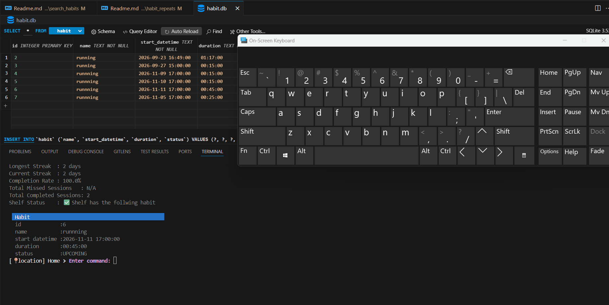
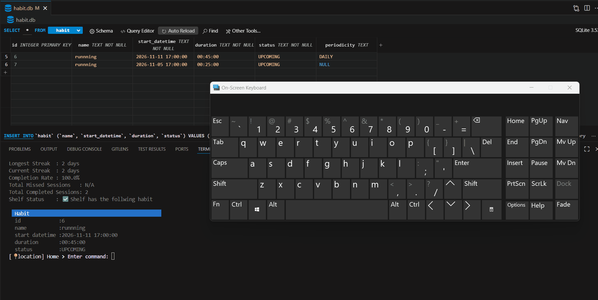
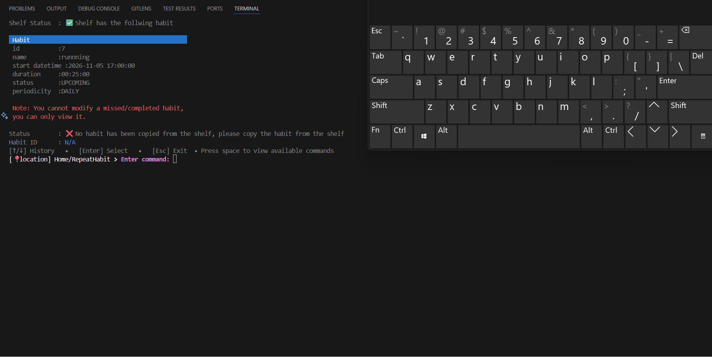
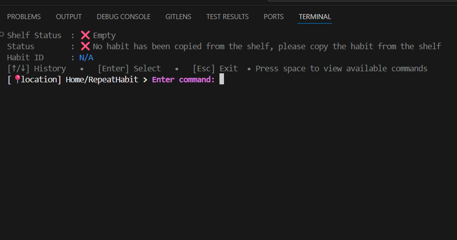
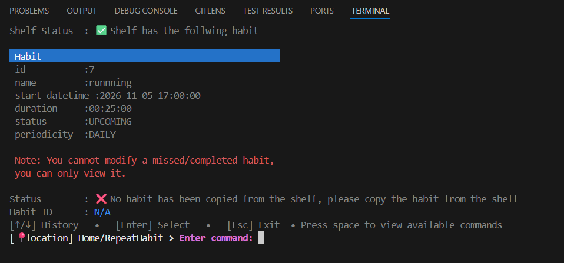
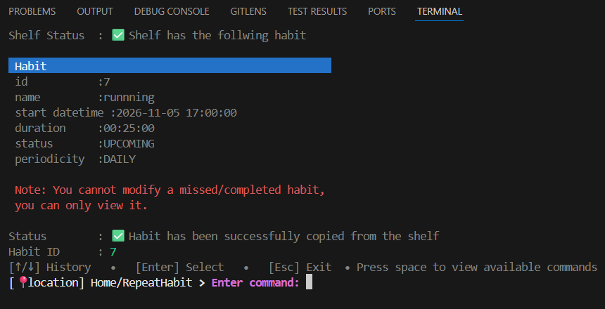

>[Go back home](../../../Readme.md)

# Repeat Habit


## Repeat Component Purpose


The **RepeatHabit** component allows users to safely delete a habit from the database via the command-line interface.
 
It ensures:

* Habit exists before deletion
* Reflections and descriptions are preserved until deletion
* User confirmation before removing

This component follows a **command-driven interaction loop**, where each user action is mapped to appropriate methods.

Gifs can be used to illustrate steps for the user in action.

---

## Table of Contents
- [Repeat Habit](#repeat-habit)
  - [Repeat Component Purpose](#repeat-component-purpose)
  - [Table of Contents](#table-of-contents)
  - [High-Level Flow](#high-level-flow)
    - [Steps to Repeatt a habit](#steps-to-repeatt-a-habit)
  - [Command Loop](#command-loop)
    - [Screen views](#screen-views)
      - [Repeat habit screen without grabbing any habit or any habit on the shelf](#repeat-habit-screen-without-grabbing-any-habit-or-any-habit-on-the-shelf)
      - [Repeat habit screen view with grabbed any habit but didn't copy it from the shelf](#repeat-habit-screen-view-with-grabbed-any-habit-but-didnt-copy-it-from-the-shelf)
      - [Repeat habit screen view with grabbed any habit copied from the shelf](#repeat-habit-screen-view-with-grabbed-any-habit-copied-from-the-shelf)
  - [Testing](#testing)

  
## [High-Level Flow](#table-of-contents)
### [Steps to Repeatt a habit](#table-of-contents)
  1.  ### [Search for a habit you want to delete](/src/components/search_habits/Readme.md)
  2.  ### Copy habit to the shelf
  3.  ### Choose a repeat type(daily, monthly etc)
  4. ### Follow instructions there

## [Command Loop](#table-of-contents)


| Command                      | Description                  | Gif                                           |
| ---------------------------- | -----------------------------| --------------------------------------------- |
| `run daily repeat pattern`             | Sets the habit name        |  [](../habit_repeats/media/repeat_daily.gif)        |
| `run weekly repeat pattern`         | Sets the start date and time|  [](../habit_repeats/media/repeat_weekly.gif)  |
| `run custom repeat pattern` | Sets the session duration     | [](../habit_repeats/media/repeat_custom.gif)  |

Each command maps directly to a handler method.

Here are other things you can do:
- Go back to the home screen (select esc)
- Clear the screen(select clear)
- get help(select help)
---
### [Screen views](#table-of-contents) 
  #### Repeat habit screen without grabbing any habit or any habit on the shelf
  [](../habit_repeats/media/repeat_without_copy.png)

  #### Repeat habit screen view with grabbed any habit but didn't copy it from the shelf
  [](../habit_repeats/media/repeat_select_habit_without_copy.png)

  #### Repeat habit screen view with grabbed any habit copied from the shelf
  


## [Testing](#table-of-contents)
```bash
python -m unittest discover -s src/components/repeat_habit/test
```
[⬆ Back to top](#top)