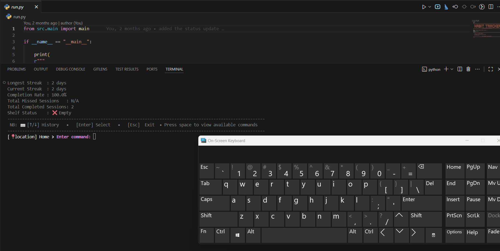

> [Go back home](../../../Readme.md)
 
## Quick Links
[Go to update habit](/src/components/update_habit/Readme.md)

[Go to delete habit](/src/components/delete_habit/Readme.md)

[Go to repeat habit](/src/components/habit_repeats/Readme.md)

# Search Habit


## Search Component Purpose


The **Search Habit Component** component provides functionality to **search for habits** based on various criteria.

Gifs can be used to illustrate steps for the user in action.

---

## Table of Contents
- [Search Habit](#search-habit)
  - [Search Component Purpose](#search-component-purpose)
  - [Table of Contents](#table-of-contents)
  - [High-Level Flow](#high-level-flow)
    - [Steps to search for a habit or habits](#steps-to-search-for-a-habit-or-habits)
  - [Testing](#testing)

  
## [High-Level Flow](#table-of-contents)

### [Steps to search for a habit or habits](#table-of-contents)
  1.  ### Search for the habit(s) you want based on the criteria of your choice.
  2.  ### Select the habit so that it can be acted on.

  Gif example of the high level flow:

  
- Go back to the home screen (select esc)
- Clear the screen(select clear)
- get help(select help)

---
## [Testing](#table-of-contents)
```bash
python -m unittest discover -s src/components/search_habit/test
```
[⬆ Back to top](#top)