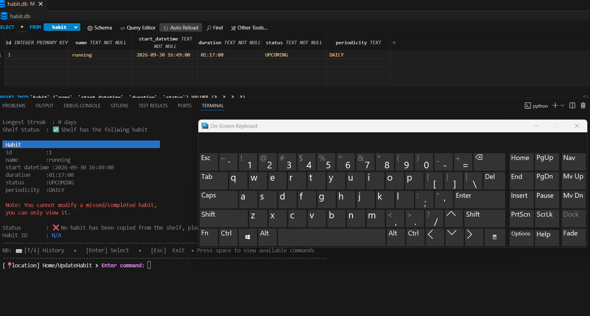
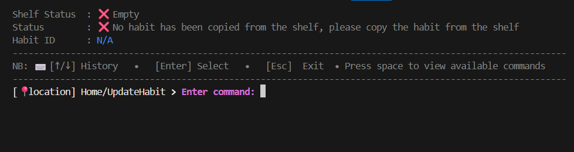
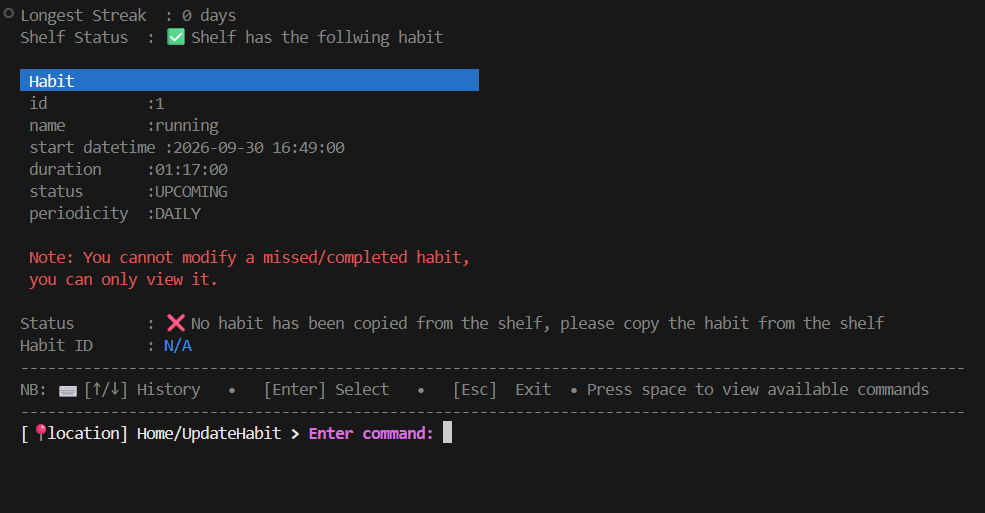
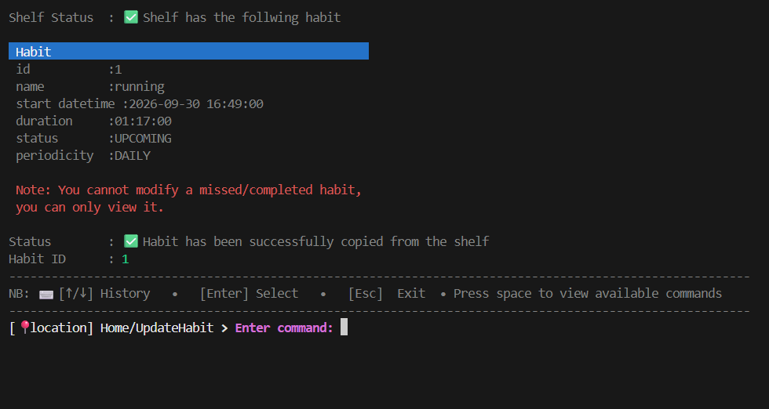

>[Go back home](../../../Readme.md)

# Update Habit

<!-- start-purpose -->
## Update Component Purpose

The **Update Habit Component** component allows users to update, complete, and view habits in the command-line interface.

It provides functionality to:

* Update habit details
* Mark tasks as completed
* Update habit statuses based on start time and duration
* View individual or multiple habits

The component follows a **command-driven loop**, where each command maps to a handler method.
<!-- end-purpose -->

Gifs can be used to illustrate steps for the user in action.

---

<!-- start-table-of-content -->
## Table of Contents
- [Update Habit](#update-habit)
  - [Update Component Purpose](#update-component-purpose)
  - [Table of Contents](#table-of-contents)
  - [High-Level Flow](#high-level-flow)
    - [Steps to update a habit](#steps-to-update-a-habit)
    - [Screen views](#screen-views)
      - [Update habit screen without grabbing any habit](#update-habit-screen-without-grabbing-any-habit)
      - [Update habit screen view with grabbed any habit but didn't copy it from the shelf](#update-habit-screen-view-with-grabbed-any-habit-but-didnt-copy-it-from-the-shelf)
      - [Update habit screen view with grabbed any habit copied from the shelf](#update-habit-screen-view-with-grabbed-any-habit-copied-from-the-shelf)
  - [Testing](#testing)
<!-- end-table-of-content -->

<!-- start-high-level-view -->
## [High-Level Flow](#table-of-contents)

### [Steps to update a habit](#table-of-contents)
  1.  ### [Search for a habit you want to update](/src/components/search_habits/Readme.md)
  2.  ### Copy habit to the shelf
  3.  ### Update habit
<!-- end-high-level-view -->

  Gif example of the high level flow:

  [](../update_habit/media/update_habit.gif)
- Go back to the home screen (select esc)
- Clear the screen(select clear)
- get help(select help)

---
### [Screen views](#table-of-contents) 
  #### Update habit screen without grabbing any habit
  [](../update_habit/media/update_habit_empty_shelf.png)

  #### Update habit screen view with grabbed any habit but didn't copy it from the shelf
  [](../update_habit/media/update_habit_not_copied_from_shelf.png)

  #### Update habit screen view with grabbed any habit copied from the shelf
  [](../update_habit/media/update_habit_copied_from_shelf.png)

## [Testing](#table-of-contents)
```bash
python -m unittest discover -s src/components/update_habit/test
```
[⬆ Back to top](#top)